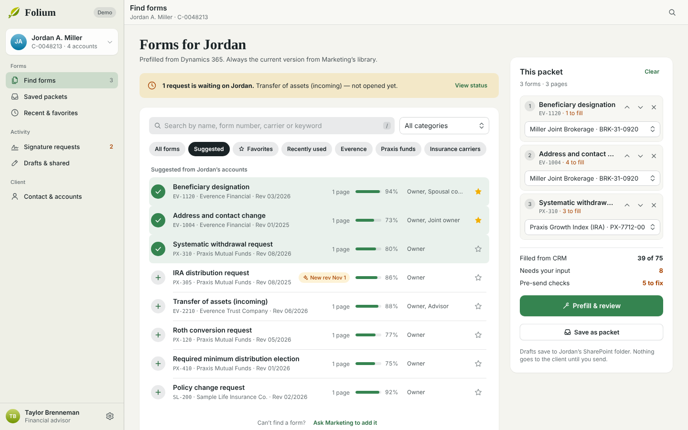
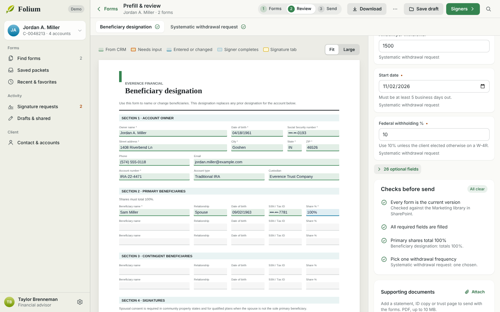
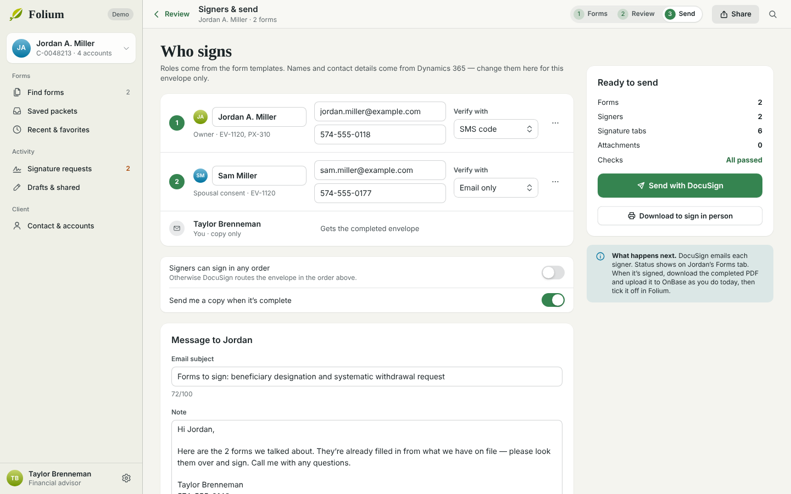
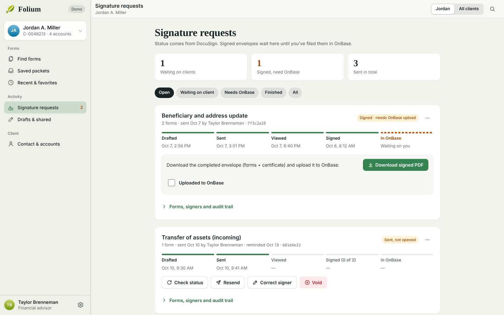
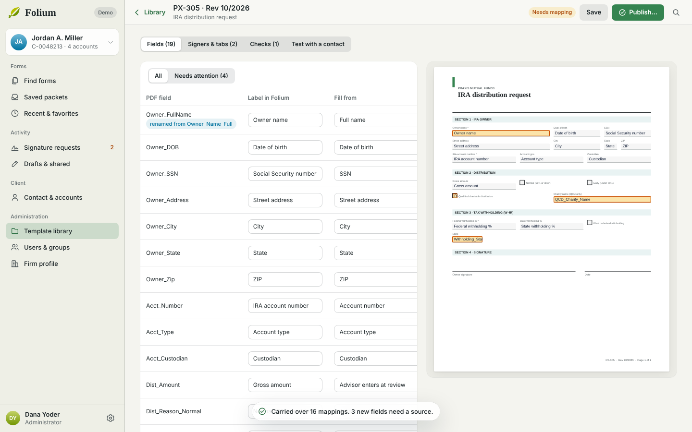

# Folium

Everence's replacement for LaserApp Anywhere. Advisors pick forms from a client's contact record, Folium prefills them from Dynamics 365, checks them for anything not in good order, and sends them for signature with DocuSign. Templates come straight from Marketing's SharePoint library, so they're always current.

*Folium* is Latin for leaf — a leaf from the Everence vine.



| Review | Send |
|---|---|
|  |  |
| **Signature requests** | **Template editor** |
|  |  |

## Try it

**Live demo:** https://theshield2594.github.io/folium/ — sample data only, rebuilt from `main` on every push.

```bash
npm install
npm run dev        # http://localhost:5173 — demo mode, sample clients and forms
npm test           # domain and PDF tests
npm run build
```

Demo mode needs nothing else: sample clients, a template library of generated AcroForm PDFs, and a simulated DocuSign that moves envelopes from Sent to Viewed to Signed over a couple of minutes. In **Settings › Demo mode** you can switch between an advisor, an assistant and an administrator. Add `?contactId=c-priya` (or `c-eli`, `c-grace`) to open a different client, the way the Contact form will. To try the recovery paths, add `?fail=offline`, `slow`, `auth` or `server` (failures start 10 seconds after launch; change with `&failAfter=`), or `?fail=send` / `?fail=release` to lose DocuSign's reply to the first envelope.

## What's in it

- **Find forms** — search by name, number or keyword; suggested from the client's accounts; favorites, recent, saved packets; ask Marketing for a missing form.
- **Prefill & review** — the real PDF with highlights for what came from CRM, what needs input, and where signers sign. Enter a value once and it fills every form that uses it. Pre-send checks catch "not in good order" problems. Download an editable (fillable) or flattened PDF, attach supporting documents, save a draft, share it with a colleague.
- **Signers & send** — signers from the template roles and the client's connections, signing order, SMS/KBA/email verification, message, reminders, expiration.
- **Signature requests** — Drafted → Sent → Viewed → Signed → In OnBase with audit trail, resend, correct signer, void, download signed PDF + certificate.
- **Contact & accounts** — fix the client's Dynamics 365 record in place.
- **Settings** — your own profile (from your Microsoft profile, with Folium overrides), sending defaults, appearance.
- **Administration** — template library with revision diff and carry-over, signature tab placement, check rules, test with a real contact, publish on an effective date; users (status and last sign-in, bulk changes, CSV import and export), groups (role, region), the firm profile and the DocuSign account (each person sends from their own DocuSign login).
- **Roles** — User, Assistant (works on behalf of the Users in their groups, like LaserApp Anywhere) and Admin.

See [docs/PARITY.md](docs/PARITY.md) for the feature-by-feature comparison with LaserApp Anywhere.

## Design

Built to Apple's Human Interface Guidelines — source-list sidebar, translucent toolbars, inspectors, sheets, segmented controls, 44 pt targets, light and dark appearance, reduced motion — in the Everence brand: the guidelines' web-accessible greens, navy and royal, Warm Gray grounds, Frutiger for text and Sabon for display (Verdana and Times as fallbacks).

## Docs

- [Architecture](docs/ARCHITECTURE.md)
- [Deploying to Power Platform](docs/DEPLOY.md)
- [Dataverse schema](docs/DATAVERSE.md)
- [DocuSign custom connector](connectors/folium-docusign.swagger.json)
